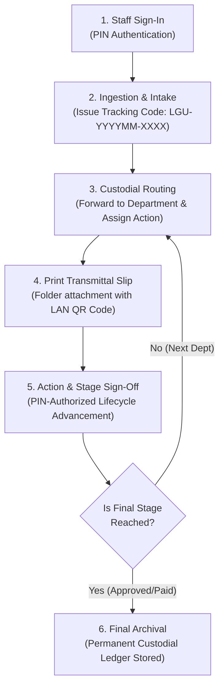

# DocTrack LGU

> **Local Government Unit Document Tracking & Custodial Routing Information System**  
> Offline-first, zero-cloud, LAN-connected document management system built for municipal offices, provincial capitols, and local government units.

---

## Overview

**DocTrack LGU** provides verifiable custodial accountability and lifecycle management for government paperwork (Disbursement Vouchers, Ordinances, Resolutions, Purchase Requests, and Permits). It operates entirely over the local office network (LAN) using a local SQLite database with zero external cloud dependencies.

### Key Capabilities

- **Zero-Cloud & Privacy-Preserving**: Operates 100% offline. Data and digital attachments stay strictly on the local machine (`tracker.db` and `./uploads/`).
- **PIN-Secured Staff Accountability**: Dedicated sign-in gate. Every stage transition, release, and receiving action requires a 4-digit PIN confirmation and is immutably logged.
- **Physical-to-Digital Transmittal Slips**: Generates 1-page printable **Republic of the Philippines Document Routing Slips** formatted for physical transmittal folders with live LAN QR codes.
- **Mobile LAN Companion**: Staff can scan the slip QR code on any phone or tablet connected to municipal Wi-Fi to review the document and sign off without installing an app.
- **Configurable Schemas & Office Queues**: Dynamic department dropdowns, configurable routing action tags, and custom data fields per document template.
- **Immutable Chain-of-Custody Ledger**: Tabular audit trail showing timestamps, custodial handovers (`Office A ➔ Office B`), required actions, and authorized staff signatures.
- **Native Windows Desktop Launcher**: One-click `.exe` launcher that spins up the background service and opens Edge/Chrome in clean standalone window mode.

---

## End-to-End System Process



### 1. Authentication & Session Gate
- Staff access is protected by an authorization screen before reaching the registry.
- Staff members authenticate by selecting their account and entering their 4-digit security PIN.
- Role-based capabilities:
  - **Admins**: Manage users, configure document templates, edit office dropdowns, and delete records.
  - **Officers / Reviewers**: Ingest records, advance lifecycle stages, forward custody, and print routing slips.

### 2. Document Ingestion & Issuance
- A receiving department (e.g., Records & Archives) registers an incoming physical or electronic document.
- The system automatically issues a standardized tracking number: `LGU-YYYYMM-XXXX`.
- Captures document title, priority (Low, Normal, High, Urgent), template schema fields (e.g., Payee, Amount, Fund Source), and optional scanned attachments (PDF, DOCX, XLSX, PNG, JPG).
- Automatically writes an immutable `created` entry into the audit ledger.

### 3. Custodial Routing & Forwarding
- When a document must change hands (e.g., *Records Office* to *Accounting Office*):
  1. Staff clicks **Forward / Route**.
  2. Selects destination department and specifies an **Action Required** (e.g., *For Pre-Audit*, *For Mayor's Signature*, *For Check Preparation*).
  3. Enters 4-digit PIN to sign off on release.
- System records the handover event: `from_office ➔ to_office`.

### 4. Official Transmittal Slip Generation
- Staff prints the standardized **Document Routing & Transmittal Slip**.
- Includes:
  - Republic of the Philippines heading & municipal office branding.
  - Tracking code, barcode, and particulars summary.
  - Action Required checkbox matrix.
  - Custodial Handover Table with printed timestamps and physical signature blocks.
  - Dynamic LAN QR code linking directly to the record for mobile inspection.

### 5. Lifecycle Advancement & Stage Verification
- Each document template defines an ordered lifecycle (e.g., *Disbursement Voucher*: `Draft ➔ Accounting Pre-Audit ➔ Treasurer Obligation ➔ Mayor Approval ➔ Check Disbursement ➔ Archived`).
- Authorized personnel advance the stage using the **Advance Stage** action and confirming via PIN.
- Real-time stage stepper visibly tracks completion percentage across the header.

### 6. Audit Inspection & Search
- Full-text search by title, code, department, action, or custom fields.
- Fast multi-facet filtering by template, office holding queue, priority, and stage.
- Real-time dashboard with holding queue counts, lifecycle distribution, and live audit streams.

---

## Default Seed Staff Accounts

The database comes pre-seeded with municipal staff accounts for immediate testing:

| Staff Name | Department | Role | Default PIN |
|---|---|---|---|
| **Administrator** | Executive Office | Admin | `1234` |
| **Mayor Arthur Vance** | Office of the Mayor | Manager | `1111` |
| **Elena Rostova** | Records & Archives Management | Officer | `2222` |
| **Clara Delgado** | Municipal Accounting Office | Reviewer | `3333` |
| **Marco Rivera** | Municipal Treasury Office | Auditor | `4444` |

---

## Tech Stack

- **Frontend**: React 19, TypeScript, Vite, Vanilla CSS + Tailwind utility variables, Lucide React icons.
- **Backend**: Node.js, Express, TypeScript (`tsx`), Multer for disk uploads.
- **Database**: SQLite via `better-sqlite3` with Write-Ahead Logging (`WAL`) enabled for fast concurrent LAN access.
- **Networking**: Node `os.networkInterfaces()` auto-detection, local IP binding (`0.0.0.0`), and custom QR matrix generator.
- **Launcher**: C# WinForms / Windows Executable (`DocTrack-LGU.exe`).

---

## Quick Start (Development)

### Prerequisites
- Node.js 18+ installed on the host machine.
- Local Area Network (LAN / Wi-Fi) connection if sharing across municipal devices.

### Installation & Run

1. Clone or copy repository:
   ```bash
   git clone <repo-url>
   cd document-tracker
   ```

2. Install dependencies:
   ```bash
   npm install
   ```

3. Start server and client concurrently:
   ```bash
   npm run dev
   ```

4. Access the system:
   - Local machine: `http://localhost:5173` (or API server on `http://localhost:3001`)
   - Network devices: Open the LAN IP shown on the top status banner or scan the QR code.

---

## Production Build & Standalone Deployment

### Build Frontend & Server
```bash
npm run build:client
```
Output builds into `./dist`. The Express server automatically serves the production assets on port `3001`.

### Build Windows Standalone Launcher
Requires Windows .NET Framework 4.0+ (built-in on Windows 10/11):
```bash
npm run build:win
```
This produces `DocTrack-LGU.exe`. When launched, it:
1. Detects whether the local Node server is running; if not, starts it silently in the background.
2. Opens the application in a clean, chromeless standalone window (via Edge or Chrome app mode).

---

## Testing & Quality Verification

Run the full automated test suite (database schema, REST API endpoints, audit logging, and authorization):
```bash
npm test
```

Expected result:
```
✓ server/api.test.ts (18 tests)
Test Files  1 passed (1)
Tests       18 passed (18)
```

---

## File Structure

```
document-tracker/
├── package.json               # Scripts and dependencies
├── tracker.db                 # SQLite local database (WAL mode)
├── uploads/                   # Local file attachment storage
├── server/
│   ├── db.ts                  # SQLite schema, queries & seed data
│   ├── index.ts               # Express API endpoints & LAN IP detection
│   └── api.test.ts            # Automated Vitest test suite
├── src/
│   ├── App.tsx                # App root & standalone sign-in gate
│   ├── api.ts                 # Type-safe client HTTP wrapper
│   ├── types.ts               # TypeScript data models & schemas
│   ├── index.css              # Custom styling & responsive grid layouts
│   └── components/
│       ├── AuthModal.tsx      # PIN keypad modal & standalone sign-in page
│       ├── NetworkBanner.tsx  # LAN status indicator & QR launcher
│       ├── DocumentList.tsx   # Contained 7-column registry table
│       ├── DocumentDetail.tsx # Stepper, metadata & tabular audit log
│       ├── RoutingSlipModal.tsx # Printable official LGU transmittal slip
│       ├── Dashboard.tsx      # Executive metrics & office queues
│       └── ...
└── windows-launcher/
    └── Program.cs             # Standalone Windows launcher source
```

---

## License

Internal Municipal Government Use • DocTrack LGU Local Edition

